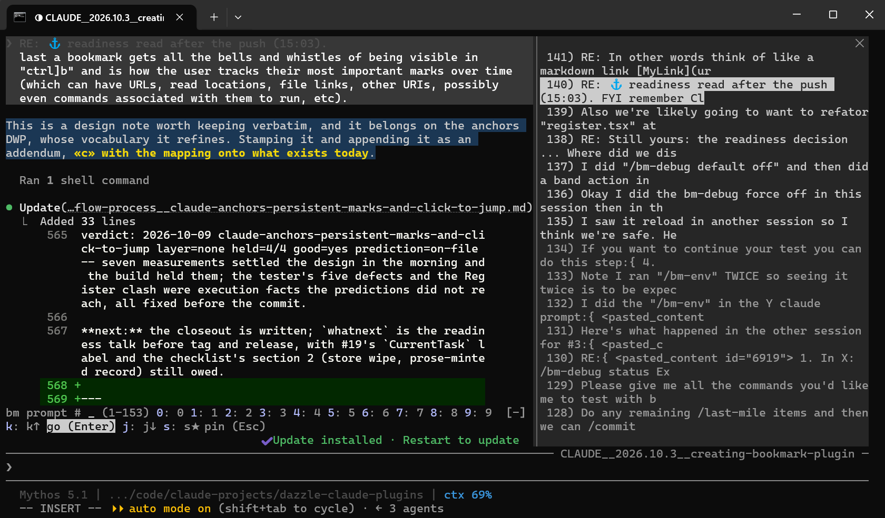

# claude-bookmarks

[](CHANGELOG.md)
[](https://code.claude.com/docs)
[](https://www.gnu.org/licenses/gpl-3.0)
[](docs/platform-support.md)

> **Vim-style marks, a reading position, and a numbered prompt history, inside a Claude Code conversation**

A Claude Code plugin that lets you mark a line of a conversation with a letter and jump back to it from anywhere, keep your place while you scroll, browse every prompt you have typed, and let Claude cite earlier places as links you can click. It is a mod, meaning it draws inside Claude Code's terminal app, with nothing else to install. In Claude Code's [official directory](https://claude.ai/directory) the plugin is called **`bookmarks`** (published by DazzleML), whereas the Github repository here is `claude-bookmarks`. (It is a terminal plugin, not a browser extension -- for navigating the claude.ai website, [AI Chat Nav](https://chromewebstore.google.com/detail/ai-chatnav/edplgflcieggamnnoecdpckjjhpjlbim?pli=1) does a similar job).

## The Problem

A long Claude Code conversation is hard to move around in. The answer you need is three hundred messages up, the prompt that started this line of work is somewhere above that, and after you scroll up to check something, finding your way back down to where you were reading is an exercise in scrolling-squinting-and-praying. Claude Code can already jump to the top and the bottom of the conversation, and its transcript view can search, but it has no way to say "remember this spot" and come back to it.

**claude-bookmarks** gives you named spots in the conversation. This includes tagged letters you set on any line (essentially [Vim marks](https://youtu.be/XT_kFia3Ua4?t=25)), a reading position you can swap to and back from, and a numbered list of every prompt you have typed, so "go back to where I asked about the cache" is two keystrokes instead of a text safari.

> [!NOTE]
> **Pre-alpha (v0.3.x).** `claude-bookmarks` is part of my daily active workflow. I've been dogfooding since Claude Code 2.1.288 (now at 2.1.295) on Win11 using Windows Terminal, fullscreen, and at different term-sizes. The mod for the most part correctly handles: inserting in-place highlights, jumps, using the reading position, navigating the prompts pane, and now works with bookmarks including clickable links in Claude's replies. **Windows is the only tested platform**. MacOS and Linux are expected to work but is untried (I'll try on a VPS after a few more minor versions). The engine under `hooks/core/` is tested and reasonably solid. Be aware the key layout will still change ([#26](https://github.com/DazzleML/claude-bookmarks/issues/26)). Also note: **[docs/status.md](docs/status.md)** tracks known issues along with what is coming in the [Roadmap](ROADMAP.md) and [issue #1](https://github.com/DazzleML/claude-bookmarks/issues/1) (the longer view). Please [file issues](https://github.com/DazzleML/claude-bookmarks/issues) for anything rough.

### Screenshot
<p align="center">
  <picture>
    
  </picture>
  <br>
  <sub>In use: the prompts pane (<code>Ctrl+] p</code>) on the right, a marked line with its <code>«c»</code> tag, a <code>⚓</code> bookmark link Claude wrote in a reply, and the band above the input box waiting for a number. <a href="docs/images/jump-pane-marks-and-reading-position.png">The jump pane</a>, with three marks and the reading position.</sub>
</p>

## Quick Start

One command installs it on Claude Code 2.1.288 or later, since this repository is also a marketplace:

```
/plugin install bookmarks --marketplace DazzleML/claude-bookmarks
```

To work on it, or to run a version before it was listed, load a local clone:

```bash
# 1. Clone the plugin
git clone https://github.com/DazzleML/claude-bookmarks.git

# 2. Load it (the plugin is the repository's plugin/ folder). For one session:
claude --plugin-dir /path/to/claude-bookmarks/plugin
#    ...or for every session, add it to ~/.claude/settings.json:
#    "env": { "CLAUDE_CODE_PLUGIN_DIRS": "/path/to/claude-bookmarks/plugin" }

# 3. Bind the leader key in ~/.claude/keybindings.json (see "Set up the leader" below)

# 4. Restart Claude Code, and switch to the fullscreen renderer if you are not on it
/tui fullscreen

# 5. Check it loaded
/bm-env
```

When the plugin is loaded, a one-line band sits above the prompt: a small `bm:` field, then four buttons, `mark jump prompts read`.

### Set up the leader

The plugin's keys all start with one **leader** key, **`Ctrl+]`**: a single key that every terminal passes on, over SSH as well. It is Claude Code's own "focus the band" action, `abovePrompt:focus`, bound to that key. A plugin cannot add a keybinding for you, so add this once to your `~/.claude/keybindings.json` (back the file up first; if the file already has a `Chat` block, add the one line to it):

```json
{
  "bindings": [
    {
      "context": "Chat",
      "bindings": {
        "ctrl+]": "abovePrompt:focus"
      }
    }
  ]
}
```

That's the whole setup. Every key in these docs is written as `Ctrl+]`. Until the binding is in place, Claude Code's built-in key for the same action, `Ctrl+X Tab` (two keys), does the same job, and the band's buttons can be clicked.

> [!TIP]
> **New to vim-style keys?** Start with the **[tutorial](docs/tutorial.md)**: it explains chords, leader keys and vim marks in plain terms, then walks you through each feature in about five minutes.

## Documentation

- **[Status](docs/status.md)** - What works today, the known issues, and the big changes coming; read this first if you are deciding whether to try a pre-alpha
- **[Every key](docs/keys.md)** - The complete key reference, grouped by where the keyboard is
- **[Tutorial](docs/tutorial.md)** - Chords, leader keys and vim marks explained, then a hands-on walkthrough
- **[Using claude-bookmarks](docs/usage.md)** - Each feature in detail: marks, jumps, the reading position, the prompts pane, bookmarks, and what is kept
- **[Troubleshooting](docs/troubleshooting.md)** - The band doesn't appear, a key does nothing, a jump is refused
- **[Platform support](docs/platform-support.md)** - Terminals and renderers, tested and expected
- **[Claude Code quirks to work around](docs/engine-quirks.md)** - Each limit of the plugin API I hit, what the plugin does about it, and what a proper fix would be

## Features

- **Marks** - Select text in any reply or prompt, press `Ctrl+] m` and a letter (`a`-`z`). With nothing freshly selected, the letter marks the message at the top of your screen
- **In-place highlight** - The marked line lights up where it sits in the conversation for two minutes, so you can see what you marked
- **Jumps** - `Ctrl+] '` and a letter scrolls back to that mark from anywhere in the conversation; the jump pane lists only the marks you have
- **Reading position** - Select a line and press `Ctrl+] Space Space` to keep your place; press it again from anywhere to go there, and again to return to where you were
- **Prompt history** - `Ctrl+] p` lists every prompt of the conversation, numbered from your first, including prompts from before the plugin was loaded; type a number, or browse with `j`/`k` or the arrows, then Enter to jump
- **Bookmarks** - Permanent, addressable places in the conversation, kept as readable files in your own folder. Claude places them while it answers and cites them as links in its reply: click one to jump there with the words highlighted, ctrl-click to open the bookmark's file. Your bookmarks and Claude's are separate lists (`Ctrl+] b`); promote any mark into a bookmark with `Ctrl+] P` and its letter
- **Back and forward** - `Ctrl+] o` returns to where you were before the last jump, `Ctrl+] i` goes forward again, like vim's jumplist
- **Works while you type** - The leader works with a draft in the input box and while Claude is working; your draft is untouched
- **Per conversation** - Marks, the reading position and the prompt list belong to the conversation they were made in, and survive restarting Claude Code and `--resume`
- **Display only** - Highlights change what is drawn on screen, never what Claude reads or what is saved in the session file
- **No extra installs** - TypeScript that runs inside Claude Code; the prompt back-fill uses the shell your system already has (PowerShell on Windows, `sh` and `grep` elsewhere)

## Usage

### Keys

| Keys | Band button | What it does |
|------|-------------|--------------|
| `Ctrl+] m` then `a`-`z` | `mark` | Mark the selected line (or the top of the screen) with that letter; `Enter` cancels |
| `Ctrl+] '` (or `j`) then `a`-`z` | `jump` | Jump to that mark |
| `Ctrl+] '` then `Enter` | `jump` | Jump to the reading position (it heads the jump pane) |
| `Ctrl+] Space Space` | `read` | Set, go to, or return from the reading position |
| `Ctrl+] p` then a number, `Enter` | `prompts` | Jump to prompt #N |
| `Ctrl+] p` then `j`/`k` or Down/Up, `Enter` | `prompts` | Browse the prompts one by one, then jump |
| `Ctrl+] p`, pick a prompt, then `s` | `prompts` | Pin or unpin it (the band stays open to pin more) |
| `Ctrl+] b` then a number, `Enter` | | Open the bookmarks pane (yours, then Claude's) and jump to bookmark #N |
| `Ctrl+] P` then `a`-`z` | | Promote that mark into a bookmark on your list (its link is copied to the clipboard) |
| `Ctrl+] o` / `Ctrl+] i` | | Back to before the last jump / forward again |
| Click a `⚓` link in a reply | | Jump to the bookmarked message, words highlighted; ctrl-click opens its file |
| `Esc` | | Leave the band and go back to typing |

After a command the keyboard stays on the band, ready for the next one; `Esc` returns to the input box. In the mark pane, letters already in use show as `●`. Prompts drawn dimmed in the prompts pane are ones Claude Code hasn't drawn on screen, usually from before the last compaction, and a jump to one may be refused (see [Tips](#tips)).

Power users can add one-step keys that press a band button directly, such as `Ctrl+X Space` for the reading position; they borrow actions of Claude Code's diff panel, so they aren't part of the default setup. See [Optional fast keys](docs/usage.md#optional-fast-keys).

### Common workflows

```text
# Keep an answer you will need again
select a line of it  ->  Ctrl+] m  a           (mark a)
...later, anywhere   ->  Ctrl+] '  a           (back to it)

# Check something above, then come back
select the line you are reading  ->  Ctrl+] Space Space   (reading position set)
scroll up, read what you needed
Ctrl+] Space Space                                        (back to the reading position)
Ctrl+] Space Space again                                  (and back to where you were)

# Go back to where a line of work started
Ctrl+] p  12  Enter                                       (prompt #12)

# Ask Claude where to read, and click your way there
"Where should I read to catch up? Bookmark each place."    (Claude answers with ⚓ links)
click a link                                              (jump; the words light up)
Ctrl+] o                                                  (back to the answer)

# Keep a mark for good
Ctrl+] P  a                                               (mark a becomes a bookmark; link on the clipboard)
```

### Commands

| Command | What it does |
|---------|--------------|
| `/bm-mark`, `/bm-goto`, `/bm-prompts`, `/bm-read` | The same as the leader keys, typed; from an empty input box their pane takes the keyboard |
| `/bm-bookmarks`, `/bm-promote a` | Open the bookmarks pane; promote mark `a` into a bookmark |
| `/bm-delmarks a b`, `/bm-delmarks all` | Delete marks |
| `/bm-pin [N]` | Pin or unpin prompt #N in the prompts pane (`*N` in its `#` field does the same) |
| `/bm-env` | Plugin version, session id, and what it has captured |
| `/bm-check` | A check of the bookmark files on disk: formats, backups, the index, the store; reports, changes nothing |
| `/bm-debug on\|off` | Echo the plugin's log into this conversation as dim rows (this conversation only; `default on\|off` and `force on\|off` reach every conversation) |
| `/bm-debug enable\|disable <channel>` | Turn a heavier diagnostic on or off for this conversation (`screen`, `held`; `/bm-debug channels` lists them) |
| `/bm-marks` | The marks set in this conversation |
| `/bm-timeline` | The last few plugin events (draws, panes, jumps) |

For each feature in detail, see **[docs/usage.md](docs/usage.md)**.

## Tips

The known limits, briefly; **[docs/troubleshooting.md](docs/troubleshooting.md)** has the details.

- **Press `Esc` to go back to typing.** After a command the keyboard stays on the band; a plugin can't hand it back to the input box itself.
- **The keys do nothing while a dialog is up** (a permission prompt, or a question Claude is asking); answer the dialog first.
- **Messages from before the last compaction usually can't be jumped to after a restart or resume**, because Claude Code then loads the conversation only from that compaction onward. The plugin copies a phrase of the message to your clipboard and tells you where to look: press `Ctrl+O`, then `[` (writes what Claude Code holds to your terminal's scrollback), then your terminal's Find (`Ctrl+Shift+F` or `Cmd+F`), and paste. Older messages may only be in the session file; opening it in full is planned ([#16](https://github.com/DazzleML/claude-bookmarks/issues/16)). For long conversations there is a way to keep the whole history in view after a restart, described in the [engine notes](docs/engine-quirks.md#patched-builds-trying-the-proper-fix-early); the plugin never depends on it.
- **"Where you were" is a whole message.** A plugin cannot read or restore the exact scroll offset, so returning from the reading position brings back the message that was at the top of the screen (or, from the very bottom, the last message's end).
- **If the plugin doesn't load after `/fork`**, the session may be hosted by Claude Code's background daemon, which doesn't load `CLAUDE_CODE_PLUGIN_DIRS`. Stop it with `claude stop <short id>` and resume it from a shell with `claude --resume <session id>`.
- **If you use the optional `Ctrl+X` fast keys** and have disabled Claude Code's built-in diff mod, or have the diff panel open, the diff panel may take those keys.

## Configuration

Open `/config` and find the plugin's one row, **▸ Bookmarks**, reading `false`: every setting is folded away behind it, since the defaults are meant to need no changing. Press `Enter` on it and it turns `true` in place: the rows below appear, the key rows and the debug rows behind folds of their own inside it. Press `Enter` again to fold them away; everything you set still applies. A change takes effect at once; `/bm-config` prints every setting, its value and where the value came from.

| Setting | Values (default first) | What it does |
|---|---|---|
| ▸ Bookmarks | `false`, `true` | The fold over every row below: folded by default; your settings apply either way |
| Prompts list opens at | `nearest`, `newest` | Where the prompts list opens: centred on the prompt nearest your view, or at the newest |
| Prompts list follows the view | `when-idle`, `always`, `never` | Whether the list scrolls to keep the yellow row showing as you scroll the conversation (`when-idle`: not while you type a number) |
| Closeness for the earlier prompt | `0.6` (0 to 1) | How much of the screen an earlier exchange must hold to count as nearest |
| Footnotes in the prompts list | `folded`, `shown`, `hidden` | Your slash commands, `!` shell commands and interruptions, listed as `N.k` under the prompt they followed: folded behind `… N footnotes`, always listed, or never |
| Prompt text kept for the filter (bytes) | `2000000` (0 = unlimited) | How much of your prompts the `/words` filter searches, newest first; past the budget the oldest prompts are matched only on the short excerpt the list shows |
| Lines per row in the lists | `2` (1 to 5) | How many lines each prompt in the prompts list, and each mark in the jump list, may take; the text is cut with an ellipsis at the end of the last line, and a second line sits under the text, not under the number |
| Prompts or bookmarks list after you pick a row | `close`, `stay` | Whether the list closes after you click a row (or type its number and `Enter`), or stays open for the next pick |
| A list while you type | `stay`, `close` | Whether an open list stays while you type in the input box |
| The band | `full`, `field` | The command field with the labelled commands and `?`, or the field alone |
| Chords on their own keybindings | `on`, `off` | Whether mark, jump, prompts and read also answer the optional chords bound to their borrowed actions |
| Lists in a pane | `on`, `off` | Whether the prompts and bookmarks lists open in a pane, or `p`/`b` take a number in the band with no pane |
| Typing a list number | `auto`, `field`, `buttons` | How the band takes a prompt or bookmark number: in a text field of its own, where Backspace, `/words` and `*N` work (`auto`, the default, and `field`), or one button per digit as before 0.6.27 |
| Keyboard after an action | `input`, `band` | Where the keyboard should go after an action (`input` waits on Claude Code allowing it) |
| ▸ Debug: show the debug rows | `false`, `true` | The fold over the three debug rows below |
| Debug: echo by default | `off`, `on` | Whether the debug log is echoed into conversations that have not chosen (`/bm-debug` decides per conversation) |
| Debug: conversation text in the log | `auto`, `off`, `with-debug`, `always` | Whether debug lines quote the conversation; `auto` is off in an installed plugin, always in one loaded from a folder |
| Debug: how much text a line quotes | `reference`, `full` | A short excerpt to find the place, or the whole text |
| ▸ Keys: show the key rows | `false`, `true` | Unfolds the rows below, which choose the band's keys; the keys you set stay when folded |
| Keys: mark, jump, prompts, ... help (one row each) | empty = the default keys | A command's keys, separated by spaces (`Space` for the space key), `hidden` last to take its button off the bar; a clash or a key the band never receives is refused with the reason ([Choosing your own keys](docs/keys.md#choosing-your-own-keys)) |
| Keys: in a list | empty = `j k s h l c d q` | The list keys renamed by position: next, previous, pin, previous group, next group, claim, remove, close |
| Keys: the leader | (shows the bound chord) | Says which chord opens the band; the leader is set in `~/.claude/keybindings.json`, not here |
| Colour overrides | JSON, empty by default | A role's colour, background, dim or bold, e.g. `{"here": {"color": "cyan"}}`; roles: `here`, `pinned`, `footnote`, `legend`, `heading`, `mark`, `markBand`, `used`, `unused`, `unreached`, `emphasis`, `search`; a colour is a theme key (`warning`, `subtle`, ...), a terminal colour name or `#rrggbb` |

Still constants, planned as settings ([#7](https://github.com/DazzleML/claude-bookmarks/issues/7)): how old a selection may be before a mark uses the top of the screen (75 seconds), where "back" from the bottom returns, whether a typed prompt number waits for `Enter`, the highlight's duration, and the pane sizes.

### Debug Logging

Every key press, pane and jump is written to a per-conversation log, kept to its last 400 lines:

```
${CLAUDE_USER_DIR:-~/claude}/bookmarks/debug/<session id>.log
```

Read its last lines first when something behaves oddly; they make a good attachment to an issue.

## Platform Support

| Platform | Status |
|----------|--------|
| Windows 11, Windows Terminal, fullscreen | Tested |
| macOS, fullscreen | Expected to work |
| Linux, fullscreen | Expected to work |
| Classic (non-fullscreen) renderer | Not supported |

Details, including tmux, IDE terminals and the Desktop app: [docs/platform-support.md](docs/platform-support.md).

## Project Structure

```
claude-bookmarks/
├── plugin/                   # The plugin, as Claude Code installs it (point --plugin-dir here)
│   ├── .claude-plugin/
│   │   └── plugin.json       # Plugin manifest (name: bookmarks)
│   ├── hooks/
│   │   ├── hooks.json        # Points Claude Code at the mod
│   │   ├── register.tsx      # The mod: the band, panes, highlight, bookmarks, back-fill
│   │   ├── core/             # Pure modules: anchor URL, transcript, register file, keys, view position
│   │   └── scripts/          # PowerShell fallbacks for reading the transcript on Windows
│   ├── types/index.d.ts      # Declared $.state values
│   ├── README.md, LICENSE    # What the plugin directory requires inside the plugin folder
│   └── tsconfig.json         # Type-check the mod: npx tsc -p plugin --noEmit
├── .claude-plugin/
│   └── marketplace.json      # This repository as a marketplace (dazzle-claude-plugins)
├── docs/                     # Status, keys, tutorial, usage, troubleshooting, platform support, engine quirks
├── scripts/repokit-common/   # Shared repo tooling (git subtree from DazzleTools/git-repokit-common)
├── tests/
│   ├── core/                 # node --test suites for the pure modules (kept out of the installed plugin)
│   ├── checklists/           # Human test checklists
│   └── one-offs/             # Probes and measurements
├── .repokit-common.toml      # Repo tooling settings (version sync into plugin/.claude-plugin/plugin.json)
└── version.py                # Version source for the repo tooling
```

## How It Works

1. **The band is (currently) the command line.** The leader (`abovePrompt:focus`) moves the keyboard to the band, where a small field takes the next key, any key, `'` and `Space` included. The band then shows what it waits for and takes the rest of the keys itself, while a pane beside the conversation shows the list. Claude Code credits a plugin's scroll or pane to your keystroke only while the key's handler is still running, so every jump happens inside that handler. The band exists because Claude Code refuses a pane the keyboard while the input box holds text; [#26](https://github.com/DazzleML/claude-bookmarks/issues/26) is the plan to land in the pane whenever it is allowed.

2. **A mark is a message plus a snippet.** Marking reads your mouse selection, finds the message it sits in, and stores the message id and the selected line under the letter, per conversation.

3. **The highlight is drawn, not written.** While a mark is shown, the plugin redraws that message with the marked line coloured. The session file and what Claude reads are untouched.

4. **Jumps ask Claude Code to scroll.** A jump asks Claude Code to reveal the stored message. If the message isn't loaded (it's from before the last compaction and the session was restarted), Claude Code refuses, and the plugin falls back to the clipboard phrase.

5. **The prompt list is back-filled once.** The first time the plugin sees a conversation, it reads the user prompts out of the session's transcript file with one shell command (`Select-String` on Windows, `grep` elsewhere), then keeps the list current as you type. Where `sh` is available it also reads the whole conversation once, in the background and in pieces (`tail | head`), keeps an index of where each message sits so later loads resume instead of re-reading, and from then on answers "which message is this?" from memory; `/bm-env` shows how far that read has got.

## Contributing

Contributions welcome! Please open an issue or submit a pull request.

See **[CONTRIBUTING.md](CONTRIBUTING.md)** for:
- Development setup (`claude --plugin-dir .` reloads the mod live when you save)
- Checks: `claude plugin validate .` and `python -m pytest tests/ -v`
- Version management with `sync-versions.py`
- Human test checklists in `tests/checklists/`

Like the project?

[](https://www.buymeacoffee.com/djdarcy)

## Related Projects

- [claude-session-logger](https://github.com/DazzleML/claude-session-logger) - Real-time per-session logging of tool calls, prompts and replies
- [Claude-Session-Backup](https://github.com/DazzleML/Claude-Session-Backup) - Git-backed backup, search and restore of Claude Code sessions, including the pre-compaction messages a bookmark can no longer scroll to
- [anthropics/claude-code#94786](https://github.com/anthropics/claude-code/issues/94786) - The feature request this project grew from: linking and anchoring to specific messages in a conversation
- [Claude Code](https://claude.ai/code) - Anthropic's CLI for Claude

## License

claude-bookmarks, copyright (C) 2026 Dustin Darcy

This project is licensed under the GNU General Public License v3.0 or later - see the [LICENSE](LICENSE) file for details.
