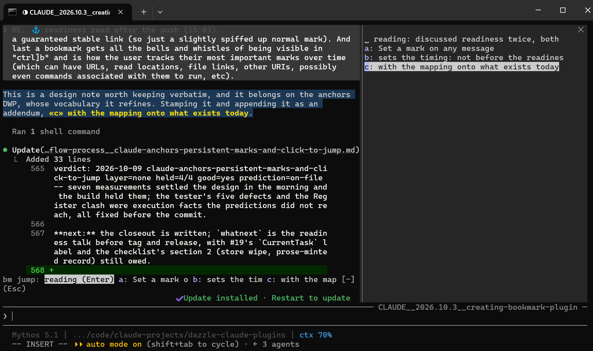

# Using claude-bookmarks

This guide explains each feature in turn: what it does, how to use it, and what it shows you along the way. It assumes the plugin is loaded and the leader key is bound; see the [Quick Start](../README.md#quick-start) if not.

- [The leader key](#the-leader-key)
- [The band](#the-band)
- [Marks](#marks)
- [Jumping to a mark](#jumping-to-a-mark)
- [The reading position](#the-reading-position)
- [The prompts pane](#the-prompts-pane)
- [Optional fast keys](#optional-fast-keys)
- [Typed commands](#typed-commands)
- [What is kept, and where](#what-is-kept-and-where)
- [Diagnostic commands](#diagnostic-commands)

For the known limits and what to do when something doesn't work, see [Troubleshooting](troubleshooting.md).

## The leader key

Every key of the plugin starts with one **leader** key, followed by one or two more keys. Vim users will know the idea; the [tutorial](tutorial.md) explains it from scratch.

The leader is `Ctrl+]`: Claude Code's own "focus the band" action, `abovePrompt:focus`, bound to a single key that every terminal passes on. It moves the keyboard from the input box to the plugin's band above it. A plugin cannot add a keybinding for you, so bind it once in `~/.claude/keybindings.json` (until then, Claude Code's built-in two-key chord for the same action, `Ctrl+X Tab`, does the same job):

```json
{
  "bindings": [
    {
      "context": "Chat",
      "bindings": {
        "ctrl+]": "abovePrompt:focus"
      }
    }
  ]
}
```

If the file already has a `Chat` block, add the one line to it. The examples below write the leader as `Ctrl+]`.

| Keys | Does |
|------|------|
| `Ctrl+] '` (or `j`), then a letter | Jumps to that mark |
| `Ctrl+] m`, then a letter | Marks the selected line, or the top of the screen, with that letter |
| `Ctrl+] Space`, then `Space` (or `Enter`) | Goes to the reading position, or back to where you were |
| `Ctrl+] p`, then a number and `Enter` | Jumps to prompt #N |
| `Ctrl+] p`, then `j`/`k` or the arrow keys, then `Enter` | Browses the prompts one by one, then jumps |
| `Ctrl+] p`, then pick a prompt, then `s` | Pins or unpins the prompt under the `▶` |

**It works with text in the input box,** and while Claude is working. The leader moves the keyboard to the band without touching your draft.

**Why `Ctrl+]`:** it sends a control code that every terminal passes on, so it needs no terminal setup, over SSH as well. Keys such as `Ctrl+;` or `Ctrl+,` reach Claude Code only if your terminal reports them; see [A leader on `Ctrl+;`](#a-leader-on-ctrl) below. On some non-US keyboard layouts `]` is hard to type with Ctrl; pick another key there.

**Getting back to typing:** after a command the keyboard stays on the band, ready for the next one. Press `Esc` to return to the input box. A plugin can't hand the keyboard back by itself.

Every key, grouped by where the keyboard is, is on one page: [keys.md](keys.md).

### A leader on `Ctrl+;`

To use a key your terminal doesn't report by default, map it in the terminal to the code Claude Code expects. In Windows Terminal, map the key to a `sendInput` of `\u001b[59;5u` (for `Ctrl+;`) in its settings, then bind `"ctrl+;": "abovePrompt:focus"`.

## The band

When the plugin is loaded, a one-line band sits just above the prompt:

```
bm: _  m: mark  j: jump  p: prompts  r: read  ?
```

The first part is a small field. When the leader puts the keyboard on the band, the field takes the next key, any key, including `'`, `Space` and `?`. The words after it are buttons you can click, and each does exactly what its key does: `mark` (`m`), `jump` (`j`), `prompts` (`p`), `read` (`r`). Jump and read also answer `'` and `Space`; why two keys, and why `j` means "next" inside a list, is in [Why some commands have two keys](keys.md#why-some-commands-have-two-keys). A pane opened by a click stays open as a list to click in; close it with its `×`.

**`?` shows every command,** including the ones the bar has no room for (`b` bookmarks, `P` promote, `o` back, `i` forward), the keys of the prompts and bookmarks lists, and how the switches below are set. Type `?` after the leader, or click it. `Enter` or `Esc` closes the help.

Three switches in `/config` change the band:

| Setting | Values | Does |
|---------|--------|------|
| The band | `full`, `field` | `field` draws the command field alone, one short row; the leader still lands there, and `?` still lists the commands |
| Chords on their own keybindings | `on`, `off` | `off`: `mark`, `jump`, `prompts` and `read` no longer answer the keybindings in [Optional fast keys](#optional-fast-keys), only the leader |
| Lists in a pane | `on`, `off` | `off`: `p` and `b` take a number in the band and jump, and `m` and `'` take their letter there, with no pane beside the conversation |

A band with nothing in it cannot take the leader, so there is no fully hidden band yet; `field` is the smallest.

When a mark has just been set or jumped to, the band also shows it after a bar, as `| a ▸ the marked line`, until the highlight clears.

After the first key, the band shows what it is waiting for, for example `mark as: cancel (Enter) · · ● · …`, with a pane beside it as the readable list. The band goes back to its field after a jump or mark, when you send a prompt, after 15 seconds, or when you press `Esc`.

Typing a key that isn't a command after the leader shows a reminder of the keys, and does nothing else.

## Marks

A mark is a letter, `a` to `z`, attached to a line of the conversation.

**To set one:**

1. Select some text with the mouse in a reply or a prompt, or just scroll to where you want the mark.
2. Press `Ctrl+] m`. The mark pane opens, listing the marks you have:

   ```
   mark as: cancel (Enter) · · ● · · …
   ```

   Free letters are drawn as `·`, letters in use as `●`.
3. Press a letter. The pane closes, a message confirms the mark, and the marked line lights up in place. `Enter` (or `Esc`) cancels without marking.

**What gets marked:**

| You have... | The mark goes on |
|-------------|------------------|
| Text selected within the last 75 seconds | The selected line (`[selection]`) |
| An older selection, or none | The message at the top of the screen (`[top of screen]`), its first line highlighted |

Claude Code remembers the last text you selected even after its highlight is gone. The 75 seconds stop an old selection, perhaps one you made to copy a quote, from deciding where a new mark goes. The time will be a setting.

**The view stays where it was.** Opening the pane narrows the conversation, which shifts what's on screen. After the mark, the plugin scrolls back to the message that was at the top before the pane opened.

**Pressing a letter that is already in use moves it**: the old mark under that letter is replaced, as in vim.

**To delete marks:** after the leader, `d` and a letter clears that mark (the letter points at nothing, and its history is kept, so `/bm-marks` still shows where it was), and `D` and a letter forgets it (its record goes too, outright when nothing else refers to it). Neither asks to confirm. Or type `/bm-delmarks m`, `/bm-delmarks a b c`, or `/bm-delmarks all`. The reading position isn't a letter and stays.

**The highlight** stays for two minutes, or until you send your next prompt, whichever comes first. It only changes what is drawn on your screen: Claude never sees it, and the session file is not changed.

## Jumping to a mark

1. Press `Ctrl+]`, then `'` (or `j`), from anywhere in the conversation. The jump pane lists the marks you have, plus the reading position when you have one.
2. Press the mark's letter. The conversation scrolls so the marked message is at the top of the screen, and the marked line lights up again.

`Enter` instead of a letter goes to the reading position.



If the mark points at a message Claude Code no longer has on screen (usually one from before the last compaction, after the session was restarted or resumed), the jump can't happen. The plugin says so, copies a phrase of the message to your clipboard, and tells you how to find it; see [Troubleshooting](troubleshooting.md#a-jump-says-it-cant-go-there).

## The reading position

The reading position is a single bookmark for "this is where I was reading". It works like a two-way switch: one press takes you there, the next takes you back.

The keys are `Ctrl+] Space Space`: the first `Space` asks for the reading position, and the second presses it (`Enter` works too). `r` does the same as the first `Space`.

**To set it:** select some text in the message you are reading and press `Ctrl+] Space Space`. The message says `reading position set: ...`. As with marks, only a selection made within the last 75 seconds counts.

**To use it:** scroll anywhere you like, then press `Ctrl+] Space Space` with nothing freshly selected:

| You are... | `Ctrl+] Space Space` does |
|------------|---------------------------|
| Somewhere else in the conversation | Goes to the reading position, and remembers where you were |
| At the reading position, having just jumped there | Goes back to where you were |
| At the reading position, having scrolled there yourself | Stays put, and says so: there is nowhere to go back to |

**"Where you were"** is the message at the top of your screen, or, when you were at the very bottom, the last message's end. So going back from the bottom returns you to the same text you were reading, even if new replies have arrived below it. The plugin can't read or restore the exact scroll position, only show a message at the top or bottom of the window. So in the middle of a long message, back lands on that message's start.

**To move it**, select text in a different message and press `Ctrl+] Space Space` again. A selection inside the message that already holds the reading position doesn't move it; that press counts as "go there".

The reading position is kept apart from the letters: it never takes up a letter, and the mark pane doesn't list it.

## The prompts pane

`Ctrl+] p` opens a list of every prompt you have typed in this conversation, newest first, numbered from your first:

```
# 12
  153) Looks good, let's do a small commit for that
  152) Then a recap and a what-next
...
▶ 12) Our readme feels a bit weak
```

The band takes the keys in a `#` field of its own, and the pane shows where you are:

| Key | Does |
|-----|------|
| Digits | Type a prompt number; it shows in the pane's `#` field, and the list scrolls to that prompt, marked `▶` |
| `Backspace` | Takes the last character off what you typed |
| `/words` | Filters the list, as the pane's own field does |
| `j` / `Tab` | Moves the `▶` one prompt down the list (older); the first press starts at the newest |
| `k` / `Shift+Tab` | Moves it one prompt up (newer) |
| `Down` / `Up` | The same as `j` / `k`, with the keybinding in [keys.md](keys.md#3-on-the-band-with-the-prompts-or-bookmarks-pane-open) |
| `Enter` | Jumps to the prompt under the `▶` |
| `s` | Pins or unpins the prompt under the `▶` (see [Pinned prompts](#pinned-prompts)) |
| `Esc` | Closes without jumping |

After a step the field is empty again, with the number shown dim in it, so the next key starts fresh; type a number before `j` (`12j`) to step from it. "Typing a list number" in `/config` set to `buttons` brings back the earlier row of digit buttons.

The list includes prompts from before the plugin was loaded. The first time it sees a conversation, the plugin reads the prompts from the conversation's transcript file in one pass. After that it adds each prompt as you send it, including messages you typed while Claude was still working, which Claude Code queues and delivers mid-turn.

**The yellow number** is the prompt nearest to where you are in the conversation, and the list opens scrolled so that row is in the middle rather than at the newest prompt. A prompt and the replies after it are one exchange; the exchange that takes most of your screen is where you are, and when two take about the same, the earlier one wins, so you have the context above as well as below. A prompt peeking in at the bottom of a long reply does not take the yellow from that reply's prompt. With nothing placeable on screen, it is the last prompt above the top of your screen. Scroll with the pane open and the yellow moves with you; the list slides only as far as it must to keep the yellow row showing, and never while you are typing a number.

**Dimmed prompts** are ones Claude Code hasn't drawn on screen since the plugin loaded. Usually that means they are from before the last compaction, which Claude Code no longer loads after a restart or resume, and a jump to one will be refused. A prompt that simply hasn't been scrolled past yet is also dim until it is drawn, so treat the dimming as a hint, not a promise.

**With an empty input box,** the typed command `/bm-prompts` opens the same pane with the keyboard in the pane itself. Then `Tab`/`Shift+Tab` step through the list, and the `#` field takes `*21` to pin.

### Pinned prompts

Pin the prompts you want to come back to, and they stay at the top of the pane:

| To | Do |
|----|----|
| Pin or unpin a prompt while browsing | `Ctrl+] p`, move the `▶` to it (`j`/`k`, the arrows, or its number), then `s`; the band stays open to pin more |
| Pin or unpin prompt #21 | `/bm-pin 21` |
| Pin or unpin your newest prompt | `/bm-pin` |
| Pin from the pane | Type `*21` (or `*` for the newest) in the pane's `#` field and press `Enter`; this needs the keyboard in the pane (`/bm-prompts` from an empty input box) |

A pinned prompt shows a gold star inside its number, `245★) `, both in a **★ pinned** group at the top of the pane (in the order you pinned them) and in its place in the full list. Pins are kept per conversation, like marks.

Each pin remembers the list it was made in. The lists to come (search, and the pane's other views) will let you pin their rows too. "Pins shown in a list" in `/config` decides whether a list shows only the pins made in it (`here`, the default) or every pin on its rows, wherever it was made (`everywhere`).

### Footnotes

Some of what you type is not a prompt: a slash command (`/compact`, `/bm-pin 21`, `/goal ...`), a `!` shell command, an interruption (`Esc` while Claude is working). These are listed as **footnotes** under the prompt they followed, numbered `N.k`, so prompt numbers stay as they were:

```
  13) Then a recap and a what-next
      … 2 footnotes
  12) Our readme feels a bit weak
```

Unfolded, the ellipsis becomes the footnotes themselves, `12.1 /compact`, `12.2 !git status`. Footnotes before your first prompt are `0.k`, at the bottom of the list. Things Claude or Claude Code did on their own (compactions, task notifications) are not footnotes: the list is for what you typed.

| To | Do |
|----|----|
| Unfold a prompt's footnotes | Click the `… N footnotes` row, or type `12.` in the pane's `#` field |
| Fold them again | Click the `▴ fold` row under them, or type `12.` again |
| Jump to footnote 12.1 | Type `12.1` and `Enter` in the pane's `#` field, or on the band type `1` `2`, click the band's `.` button, `1`, `Enter` (a band key is one letter or digit, so `.` is a button there) |

The "Footnotes in the prompts list" setting chooses `folded` (the default), `shown` (always unfolded) or `hidden`. With `hidden` the rows are gone but the numbers still work: `12.1` jumps to that footnote, and `12.` says the footnotes are hidden. Footnotes are read from the transcript with the prompts and added live after that. A few commands Claude Code runs itself and records apart from your messages (`/goal clear`, `/rename`, `/branch`, `/cd`) are not seen live and appear from the next session start.

A row shows as much of its prompt as fits the pane's width, over as many lines as the "Lines per row in the lists" setting allows (the default is 2; 1 to 5). The text is cut with an ellipsis at the end of the last line, and a second line sits under the text, not under the number, so the numbers stay a column. Widen the pane for more of each prompt per line; set 1 for the densest list. The jump list's rows follow the same setting.

### Filtering the list

Type `/` and some words in the pane's `#` field to list only the prompts containing all of them, in any order and any case: `/band redraw` finds "the redraw of the band". Prompts keep their numbers, and a line above the list says how many match, `/band redraw: 2 of 153 match`. Pinned prompts are filtered too. Clear the field to see the whole list again, or press `Esc`: with a filter active, the first `Esc` clears the filter and the second closes the pane. Typing in the field needs the keyboard in the pane (`/bm-prompts` from an empty input box).

The filter searches the whole text of your prompts, not only the excerpt the list shows. That text is kept per conversation up to a budget, "Prompt text kept for the filter (bytes)", 2 MB by default, newest first; past it, older prompts are matched on their excerpt alone. `0` keeps everything, for a machine with room to spare. It is kept in your own folder, `~/claude/bookmarks/prompttext/` (beside the bookmarks), not in Claude Code's plugin storage, which has a small limit shared by everything the plugin keeps.

## Searching the conversation

`Ctrl+] /` (or the bar's `/search` button, or `/bm-search some words`) opens the search pane. It searches every row the conversation has, not only your prompts: Claude's replies and thinking, every tool call and its output, agents' messages, and messages from other sessions. With the field empty it lists them all, newest first.

```
/ loader_
●all ·you ·claude ·agents ·sessions ·tools ·outputs ·thinking ·notices ·other
everything: 4 of 1,284 places
  1) claude: The loader is in src/loader.ts
  2) output: src/loader.ts:51
  3) Bash: grep -rn loader src
  4) you: find the loader please
```

The band takes the keys, as for the lists: what you type in its field is the query, and the results narrow as you type. The results are numbered in their own list, 1 the newest at the top.

| On the band, in search | Does |
|------------------------|------|
| words | Every word, in any order and any case |
| `"a phrase"` | That exact text, case and all |
| `m/pattern/i` | A regular expression |
| `in:tools`, `from:claude`, `tool:Bash`, `agent:oracle`, `failed` | Narrows to those rows; `-in:thinking` leaves them out |
| `Tab` / `Shift+Tab`, or the `↓` / `↑` buttons | Moves the `▶` down / up the results; the first step lands on 1 |
| `Enter` | Goes to the result under the `▶` (the newest when there is none) |
| `#12`, then `Enter` | Goes to result 12; the `▶` moves there as you type the number |
| `*12`, then `Enter` | Pins or unpins result 12 (a `★` beside it); the band stays open to pin more |
| `Esc` | Leaves the band; the pane stays |

Every letter you type is part of the query, so `j`, `k` and `q` are not keys here. The pane's own row of toggles narrows by kind: click `tools` to see only tool calls, `you` and `claude` together for the conversation itself, `all` for everything again. The toggles combine with whatever `in:` words the query holds.

Going to a result lands where Claude Code draws it. A prompt or a reply lands with your words highlighted; a tool call or its output lands on the tool's row, or on the folded "Ran 1 shell command" line that holds it; an agent's message lands on the Agent call that started it. The result you last went to stays in yellow, so you can see which one it was. A thinking block lands on its message, folded: ctrl+o shows it.

The first search in a conversation reads all of its files, which in a long conversation takes a while; the pane says it is still reading and fills in as it goes. What it read is kept under `~/claude/bookmarks/places/`, so a later search, even after a restart, starts at once. The search settings sit in `/config` behind their own fold, "▸ Search: show the search rows", inside **▸ Bookmarks**:

| Setting | Values |
|---------|--------|
| Search: what it opens on | `all` (the default); `you+claude+sessions+tools+outputs`, what the conversation shows on screen with other sessions' messages; `you+claude+sessions`; or `custom`, which shows one "Search: custom includes ..." row per kind to turn on or off. A toggle you press in the pane stands for the rest of the conversation. |
| Search: the row of toggles | `shown` or `hidden` |
| Search: how a result says what it is | `words` (you, claude, thinking, output), or `short`: each kind word cut to its first letters on the result rows (`cl`, `th`, `ou`); a tool keeps its name and an agent its type, and the toggle row keeps its words |
| Search: letters in a short kind | 1 to 6, shown while the labels are `short`: 2 (the default) gives `cl`, 3 gives `cla` |
| Search: labels in a one-kind view | `implied` (the default): with one toggle on, a label that only repeats it is left out, so `claude` alone lists replies with no `claude:` while a thinking block still says `thinking:`; a tool's name, an agent's type and a failed output always stay. `always` keeps every label. |
| Search: how a result is laid out | `stacked` (the default): a long kind such as `mid-engineer · SubagentHandback` gets a line of its own with the text indented below, while short kinds such as `you` or `Bash` stay beside their text; or `inline`, every text beside its kind. With "Lines per row in the lists" at 1 it is always inline. |

## Bookmarks

A mark is a letter you can reassign in a second. A **bookmark** is permanent: a durable address of one message in this conversation, kept in a readable file under your own folder, that still resolves in a later session and that a link can point at. Claude places bookmarks while it answers, and you can promote any mark into one.

### Links in Claude's replies

When Claude cites an earlier place in the conversation, it writes an ordinary markdown link, drawn with a `⚓` marker and a legend line under the reply:

```
As you said when we chose the name (⚓ the catalog name decision), ...
⚓ click: jump there · ctrl-click: open the bookmark's file
```

| On the link | Does |
|-------------|------|
| Click | Jumps to that message and highlights the words the bookmark names (the same colours as a mark) |
| Ctrl-click | Opens the bookmark's own file in your default markdown application |
| Hover (Windows Terminal) | Shows the full address |

A `▤` marker on a link means it opens a file (a document, a source file); web links carry no marker. The markers are added when the reply is drawn; nothing in the transcript changes.

### Two lists

Bookmarks come in two lists that never mix: **yours** and **Claude's**. Claude bookmarks places for its own discussion without touching your list; when you ask it to "bookmark this for me", it goes on yours. Claude can also relabel or remove a bookmark on request (a removal is archived, not deleted), and **share** one of its own onto your list.

### The bookmarks pane

`Ctrl+] b` opens the list on your own bookmarks, numbered in the order they were made (so a number stays good), and `l` / `h` switch the group: yours, Claude's, all:

```
# _
[yours] · Claude's · all   (h/l switch group; or Tab / Shift+Tab, Enter)
  3) ⚓ Set a mark on any message
     (12m, you said it)
```

The band takes the keys, as for prompts: digits type a number, `j`/`k` move the `▶`, `l`/`h` switch the group (the band shows which), `Enter` jumps and highlights the bookmark's words, `c` moves Claude's bookmark under the `▶` onto your list, a number then `d` removes that bookmark from your list, `Esc` closes. Clicking the bar's `bookmarks` button (or `prompts`) while its pane is open closes the pane; the typed key never does. Numbers are shared across the groups, so #3 is #3 in every view. `/bm-bookmarks` from an empty input box puts the keyboard in the pane itself.

### Promote a mark into a bookmark

`Ctrl+] P` then the mark's letter (`` ` `` for the reading position) makes a bookmark of that mark's message, with the mark's words, on your list. The letter stays as it was. The bookmark's markdown link is copied to your clipboard, ready to paste into a note or an issue. `/bm-promote a` does the same.

### Back and forward

Every jump (a bookmark link, a mark, a prompt number, the reading position) is remembered, like vim's jumplist:

| Keys | Does |
|------|------|
| `Ctrl+] o` | Back to where you were before the last jump |
| `Ctrl+] i` | Forward again |

The reading position is separate and is never moved by a jump. Arrow keys can't reach the band, so for `Alt+←` / `Alt+→` add a terminal mapping that types the leader and the key for you; in Windows Terminal's `settings.json`, under `actions`:

```json
{ "command": { "action": "sendInput", "input": "\u001do" }, "keys": "alt+left" },
{ "command": { "action": "sendInput", "input": "\u001di" }, "keys": "alt+right" }
```

(`\u001d` is `Ctrl+]`.) The same trick works for any leader command.

### What Claude's tool does

Claude has a `bookmark` tool. It gives a verbatim fragment of the message (or its uuid) and a label, and gets back the markdown link to cite with. The place can be any row the chat window draws: a prompt or a reply, a tool call (by a fragment of its command, or by its `toolu_` id), a tool's output, an agent's message. A link to a tool row lands on that row, or on the folded line that holds it; for a tool Claude Code draws no row of its own for (an `AskUserQuestion` call, for one), it lands on the reply the call was made in and says so. Its file is named `<id>.p<part>.md` so two rows of one message never share one. In a long conversation the first such link can answer that the conversation is still being read; asking again a moment later finds it. The tool resolves the fragment against the conversation's transcript (the earliest message that contains it; if several do, it asks rather than guessing), records the bookmark, writes its file, and returns the link. Its other actions: `relabel`, `remove`, `share`, `claim`, and `list` (both lists with their tiers; a link only for a record whose file exists). Every answer carries the record's number (`n`), the one the short reference will use. A `meta` parameter lets Claude keep `tags` (a list, nested with `/`) and its own notes (`x`) on a record; a relabel replaces the tags and merges the notes. The label is what the place says; the `why` is what it decides or why it matters.

A record has a tier. Claude's own references are `perma` by default: a stable link it cites in its reply, drawn without the `⚓` so its references don't look like bookmarks you made. `bookmark` is a named place you will want to find again; that is the default when Claude bookmarks something for you, and Claude can make any of its references one by passing `tier: "bookmark"`. A bookmark never drops back to perma. `claim` moves one of Claude's records onto your list, with the same message, id and link; ask Claude to claim it for you.

The tool's own calls are folded away so a reply full of links stays readable. A reply's bookmark calls draw as one dim line where the first call was, `⚓ 5 bookmark calls ▸`. Press it to list one line per call (`⚓ bookmark #95: <label> ▸`), and press a call's line to see its row and its answer as Claude Code draws them. ctrl+o shows every call in full whatever is open. Calls made before the plugin last loaded (in a resumed conversation, say) each draw their own line, as they belong to no reply this load saw.

### Where bookmarks live

Under your own folder, never under `~/.claude` (Claude Code cleans that):

```
~/claude/bookmarks/sessions/<session id>.json        the register: every bookmark of the conversation, readable JSON
~/claude/bookmarks/sessions/<session id>/<uuid8>.md  one file per bookmarked message: the text, every field, a verify recipe, and a Notes section
~/claude/bookmarks/sessions/index.json               every conversation with bookmarks: title, project, and each bookmark's number, label, list and tier
~/claude/bookmarks/sessions/INDEX.md                 the same as a page: a heading per conversation, newest first, each bookmark linking its file
```

The two index files are generated -- rebuilt when a conversation starts, the conversation's own entry refreshed after every save -- so what you write in them is overwritten. `INDEX.md` is the page to open first in Obsidian.

(`CLAUDE_USER_DIR`, if set, replaces `~/claude`.) The link's address names that file, with the message's uuid, its line in the transcript and its byte range in the query string:

```
file:///C:/Users/you/claude/bookmarks/sessions/<session>/12d637fb.md?u=<uuid>&l=5768&b=9763906-9765751&q=the%20words&v=1
```

The file's **Notes** section is yours: anything below its marker line survives when the bookmark is relabelled. Add context, links, or your own notes there.

**In Obsidian:** the file is a note. Open `~/claude/bookmarks` as a vault (or add it to one) and its front matter shows as properties: `tags` (the bookmark's own, then `bm/tier/...` and `bm/owner/...` for each record on the message, which a vault search can filter by), `aliases` (the other list's label when the same message is on both), `title` and `project` of the conversation. Three properties are yours to edit there: `label`, `why` and `tags`. The next time the plugin touches that bookmark -- a relabel, a share, a claim -- it reads those three back before rewriting the note, so what you typed in Obsidian becomes the bookmark's. Everything else in the front matter is the plugin's and is rewritten; a note written by a plugin older than 0.5.9 is rewritten whole and never read back.

**By hand, with no plugin:** a bookmark is only a transcript line. `grep -n` the words in the session's `.jsonl` for the line number, `head -n <line-1> | wc -c` for the byte offset, and write the link in the form above; the plugin recognises it when drawn and records it.

### One file per conversation: forks, resumes and references

The register belongs to one conversation, and its name is that conversation's session id. `claude --resume` reopens the same conversation, so it reads the same file. A **forked** conversation (one branched from an earlier point of another) is a new conversation with a new id, and it starts with an empty register: the records of the conversation it branched from are not copied, even though the transcript it copied contains the same messages. That is the rule for the 0.5.x line; following a fork is tracked in [#39](https://github.com/DazzleML/claude-bookmarks/issues/39) and will come as its own change rather than as a side effect of how files are named.

The file carries a `version` (how many format migrations it has been through) and a `format` (the oldest plugin that can still handle its data). A plugin that finds a file whose `format` is newer than what it knows reads it in full and refuses to write it (a toast says so once when the conversation loads, and any bookmark action that would save answers "not saved"); update the plugin to write it again. A plugin that finds an older `version` brings the file up to date when the conversation starts, keeping a copy of the original under `backups/` first. The two numbers are explained under [What to back up, and what a reinstall does](#what-to-back-up-and-what-a-reinstall-does).

Every record is addressed in two ways. The full address is the link above, which names the message's uuid and never changes. The short reference, for citations once records carry a number `n` (coming in 0.5.x), is **`bm:<sid8>.<n>`**: the first eight characters of the conversation's session id, a dot, the record's number in that conversation. Inside its own conversation `bm:<n>` is enough. A short reference is resolved by the register file whose name starts with `<sid8>`; if no file by that name exists (the file was moved or renamed), by reading every register's header for a matching `sessionId`; and if that finds two, the reference is ambiguous and the full uuid decides. Numbers are never reused within a conversation, so `bm:13` means the same record for the life of the file. Until the number lands, the plugin writes only the full link.

## Lists

A list is a named, ordered list of things you are keeping track of: what is left to do, tests still to run, ideas for later. Each item is a place in a conversation (a prompt, a reply, a tool call, its output), a link to a file or a web page, or a plain line of text. Lists belong to the project (the folder Claude Code runs in), not to one conversation, so a list made today is there in tomorrow's conversation too.

`/bm-lists` opens the lists pane. In fullscreen, at 110 columns or wider, it docks beside the conversation on the right as its own tab, so it can stay open next to the prompts or search pane. It opens without taking the keyboard, so you can keep typing while it is up, and every action in it is a press:

- the row at the top names each list with how many items are still open; press one to show it (`◆` marks Claude's own lists);
- press an item to go to it. A place in this conversation lands as a bookmark link does; a place in another conversation copies the `claude --resume` command for it; a link is copied. An item with a place or a link is drawn as a link, so a ctrl-click opens it instead (the place's note, the file, the web page), as links in Claude's replies do;
- press an item's number to open it in place: its whole note, wrapped, where it points, and who added it and when. Press the number again to close it. A plain note, with no place or link, opens on a press of its label too;
- `▲` and `▼` move an item; `·` ticks it done (`✓`), and a done item stays in the list, dimmed.

`/bm-lists <name>` opens on that list (a part of its name is enough), `/bm-lists 2` on the second tab; `/bm-lists` again closes the pane.

Claude keeps lists through its `lists` tool: it can create a list, add items (by a fragment of the place, as its bookmark links do, or by a link, or as plain text), move, tick and remove them, and share a list onto the other side. Ask it to "keep a list of what's left" and it makes one on your side; it also keeps lists of its own. The tool is found when needed rather than sent with every message, so it costs nothing while unused.

The lists are kept in `~/claude/bookmarks/lists/<project>.json`, with the last version beside it as `.bak`, and as a page, `<project>.md`, with every item a link, for reading the lists outside Claude Code (in Obsidian, say). The page is rewritten on every change.

## Optional fast keys

For one-step actions, a key can press a band button directly. It goes through one of the few actions of Claude Code's diff panel that do nothing in a conversation:

```json
"ctrl+x space": "app:diffFileListDown"
```

in the same `Chat` block gives one-step reading: `Ctrl+X Space` goes to the reading position and back, and works with text in the input box too.

"Chords on their own keybindings" in `/config` turns them all off without editing `keybindings.json`, to try the plugin without them.

These are for power users, and not part of the recommended setup:
- **They borrow Claude Code's diff-panel actions.** While the diff panel is open, it takes them over, and a future Claude Code may remove them.
- **Only about four exist,** so they are reserved for the most common one-step actions.

**The older chords** `Ctrl+X m` (`app:toggleDiffNoiseFilter`), `Ctrl+X '` (`app:toggleDiffPreSession`) and `Ctrl+X p` (`app:cycleDiffBase`) still work if bound, but they don't work with text in the input box. The leader replaces them, and they will be removed in a later version.

## Typed commands

| Command | Does |
|---------|------|
| `/bm-mark` | Opens the mark pane |
| `/bm-goto` | Opens the jump pane |
| `/bm-prompts` | Opens the prompts pane |
| `/bm-read` | Goes to the reading position, or back |
| `/bm-bookmarks` | Opens the bookmarks pane |
| `/bm-lists [name]` | Opens the lists pane (on that list), or closes it |
| `/bm-promote a` | Promotes mark `a` into a bookmark on your list |
| `/bm-delmarks a b`, `/bm-delmarks all` | Deletes marks |
| `/bm-pin [N]` | Pins or unpins prompt #N (the newest without a number) |

From an empty input box, a pane opened by a command takes the keyboard, so its own keys work: the arrows, `Tab`, `Enter`. A command typed into the input box can't open a pane over other text, so for that the leader is the route.

## Settings

The plugin's settings are in Claude Code's `/config`, at the bottom of its list, each row ending `· bookmarks`; type `bookmarks` in its search box to see only them. They start folded away behind one row, **Bookmarks**, because the defaults are meant to need no changing: press `Enter` on it to turn it `true` and see them, and again to fold them; everything you set still applies while folded. The rows that choose the band's keys are folded once more, behind **Keys: show the key rows**, and the debugging rows behind **Debug: show the debug rows**; each opens and closes the same way, with `Enter`. Each takes the command's keys separated by spaces, with `hidden` last to take its button off the bar; a key that clashes or never reaches the band is refused with the reason. The whole syntax is in [Choosing your own keys](keys.md#choosing-your-own-keys). The README lists them all ([Configuration](../README.md#configuration)). A change takes effect at once. `/bm-config` prints each setting, its value, and where the value came from: `default`, or `/config` when you chose it.

Two of them decide what the debug log may quote from the conversation. "Debug: conversation text in the log" (behind **Debug: show the debug rows**) is `auto` by default: off in a plugin installed from a marketplace, always in one loaded from a folder (a developer's build). `with-debug` quotes only while the conversation's debugging is on (`/bm-debug on`), `always` and `off` mean what they say, and the `text` debug channel turns quoting on for one conversation whatever the setting. "How much text a debug line quotes" is `reference` (a short excerpt, enough to find the place) or `full`.

Every colour the plugin draws has a role, and its default is one of Claude Code's theme keys wherever one fits, so it follows your theme: `here` (the prompt nearest your view), `pinned` (the pin star, the bookmark anchor), `mark` and `markBand` (a mark's words and the band behind its line; the band is pale on a light theme and navy on a dark one), `legend` (hints and titles), `heading` (the prompts list's group headings, "★ pinned" and "all prompts": a dim blue-gray, darker on a light theme), `used` and `unused` (mark letters taken and free), `unreached` (a prompt not drawn since the plugin loaded), `emphasis` (what you are typing), `footnote` (the prompts list's footnotes) and `search` (for a feature to come). "Colour overrides" takes JSON naming roles: `{"here": {"color": "cyan"}, "markBand": {"backgroundColor": "#203040"}}`. A colour is a theme key (`warning`, `subtle`, `suggestion`, ...), a terminal colour name (`cyan`, `yellowBright`) or `#rrggbb`; `dimColor` and `bold` take `true` or `false`. Anything else is ignored and the default stands.

## What is kept, and where

| What | Kept for | Notes |
|------|----------|-------|
| Marks `a`-`z` | Forever | In the conversation's bookmark file since 0.5.5, each letter with its history: re-marking a letter keeps the old place as `a_001`, deleting a mark keeps the history too |
| Reading position | Forever | The same file, under its own key |
| The prompt list | This conversation | Up to 5000 prompts, with their footnotes; set aside after 30 days unopened, and read again from the transcript when you reopen the conversation |
| Prompt text for the filter | This conversation | Up to the budget setting, 2 MB by default, newest first; in `~/claude/bookmarks/prompttext/` |
| Pinned prompts | Forever | In the conversation's bookmark file since 0.5.4 |
| Bookmarks (yours and Claude's) | Forever | In `~/claude/bookmarks/sessions/`, readable JSON and markdown; never under `~/.claude` |
| The jumplist (back/forward) | This conversation | Up to 100 jumps |
| The highlight | Two minutes, or until your next prompt | Display only |

Each conversation has its own marks: `a` in one conversation is unrelated to `a` in another. Marks, the reading position, pins and bookmarks all live in the conversation's bookmark file in your own folder (see [Where bookmarks live](#where-bookmarks-live)); Claude Code's own plugin storage keeps only what the transcript rebuilds (the prompt list) and the session's UI state (the jumplist, the reading position's way back). Without a data folder, marks fall back to that storage. Nothing is written to the session file.

### What to back up, and what a reinstall does

Everything under `~/claude/bookmarks/` falls into four kinds, and the folder carries a `README.md` the plugin writes that says which is which:

| Kind | Where | What it means |
|------|-------|---------------|
| **Authored** | `sessions/<session id>.json`, `sessions/<session id>/<uuid8>.md`, `sessions/<session id>.state.json`, `lists/<project>.json` | What you and Claude made: bookmarks, marks, pins, notes, lists. Nothing rebuilds them. Back these up |
| **Backup** | `sessions/<session id>.json.bak`, `lists/<project>.json.bak`, `backups/` | Copies the plugin took: the file before its last change, the originals of each format migration with a manifest, and the one snapshot taken before the first migration on a machine. Keep them as long as you might want to go back |
| **Cache** | `prompttext/`, `debug/` | Rebuilt or regrown when missing: the prompt text the filter searches, the log |
| **Generated** | `sessions/index.json`, `sessions/INDEX.md`, `lists/<project>.md`, `README.md` | Rewritten by the plugin from the authored files; edits to them are overwritten |

A backup tool that versions your home folder should take `~/claude/bookmarks/sessions/`, `lists/` and `backups/` and may skip the caches. ([claude-session-backup](https://github.com/DazzleML/Claude-Session-Backup) is adding `~/claude` to what it versions; this table is the classification it uses.)

**Reinstalling the plugin.** The bookmark folder is yours and a reinstall never touches it. Claude Code's own plugin store is another matter: it is named after the plugin's install identity, so a reinstall under another marketplace name starts an empty store -- the prompt list is read again from the transcript, the jumplist starts empty -- and your `/config` choices for the plugin reset to their defaults. Marks, pins and bookmarks are unaffected, because since 0.5.5 none of them lives in the store. If you are on a version before 0.5.5, upgrade first and open each conversation whose marks you want once, so they migrate into the bookmark file, before you reinstall.

**Two numbers in a bookmark file.** `version` counts the format migrations the file has been through; a newer plugin migrates an older file at the conversation's start, after copying the original under `backups/`. `format` is the oldest plugin that can still handle the file's data; a plugin refuses to write a file whose `format` is newer than what it knows, and reads it instead. The two move together so far (1, 2, 3); they are separate so that a future migration an older plugin can live with does not force anyone to upgrade.

## Diagnostic commands

The plugin adds a few commands from its proof-of-concept stage. They are useful when reporting a problem:

| Command | Shows |
|---------|-------|
| `/bm-env` | The plugin's version, the Claude Code version, the session id, and what the plugin has captured |
| `/bm-check` | The bookmark files on disk, checked: each register's format against this build, note folders with no register, the index against the registers, each migration's run folder (its status and whether the copies still match their hashes), the snapshots, and the store's size against its cap. It reports and changes nothing; where something is off, the line says what the next start or save will do about it |
| `/bm-marks` | The marks set in this conversation |
| `/bm-timeline` | The last few plugin events: draws, panes, jumps, toasts |
| `/bm-diag-keys` | Turns on (or off) logging of each key typed in the input box, to the plugin's debug log: lengths and key names, never the text |
| `/bm-debug ...` | Whether the plugin's log lines are also drawn in the conversation as dim rows (see below) |

These commands are left over from the proof of concept and will be renamed in the rebuild.

### The log echo

The plugin always writes its log to a file, one per conversation (see [the debug log](troubleshooting.md#the-debug-log)). It can also echo each line into the conversation as a dim row while you watch it work. The echo is off unless asked for, and it is asked for per conversation:

| Command | Effect |
|---------|--------|
| `/bm-debug on`, `/bm-debug off` | This conversation only. The choice is kept in this session's own environment, so it survives the plugin reloading, reaches any process this session starts, and ends when the session does: a resumed conversation starts from the default again. |
| `/bm-debug reset` | This conversation follows the default again. |
| `/bm-debug default on`, `/bm-debug default off` | The default for every conversation that has made no choice of its own. |
| `/bm-debug force on`, `/bm-debug force off` | Every conversation, no exceptions, until lifted with `/bm-debug default on` or `off`. Use it to watch every open session at once, or to guarantee silence everywhere. A session's own `on` is remembered and applies once the force is lifted. |
| `/bm-debug status` | Which of these is in effect, and the log file's path. |

The same per-conversation signal can be given from the shell: `CONVO_BOOKMARKS_DEBUG=1 claude` starts a session with the echo on (`0`, `off` or `false` for an explicit off). The default and the force are the only settings written to disk; a conversation's choice never is.

### Debug channels

Some diagnostics are too heavy or too narrow to run all the time, so each is a channel, off until you turn it on for one conversation:

| Channel | What it adds |
|---------|--------------|
| `screen` | Every on-screen report Claude Code sends the plugin, written to `<session id>.screen.log` beside the debug log. Heavy: the file is rewritten every half second while the screen redraws. For a prompts pane whose highlight lands on the wrong prompt. |
| `held` | A log line naming the rule that kept the prompts pane's yellow row where it was. |
| `text` | Log lines quote the conversation (the selected words, a message's first line, a bookmark's label) in this conversation, whatever the "Conversation text in the debug log" setting says. |

`/bm-debug channels` lists them with their state; `/bm-debug enable screen,held` and `/bm-debug disable screen` switch them. The choice is kept with the echo's, in the same variable of this session's own environment, so it ends with the session. From the shell, channel names join the echo's value: `CONVO_BOOKMARKS_DEBUG=screen claude` for the screen channel alone, `CONVO_BOOKMARKS_DEBUG=1,screen claude` for the echo as well.
